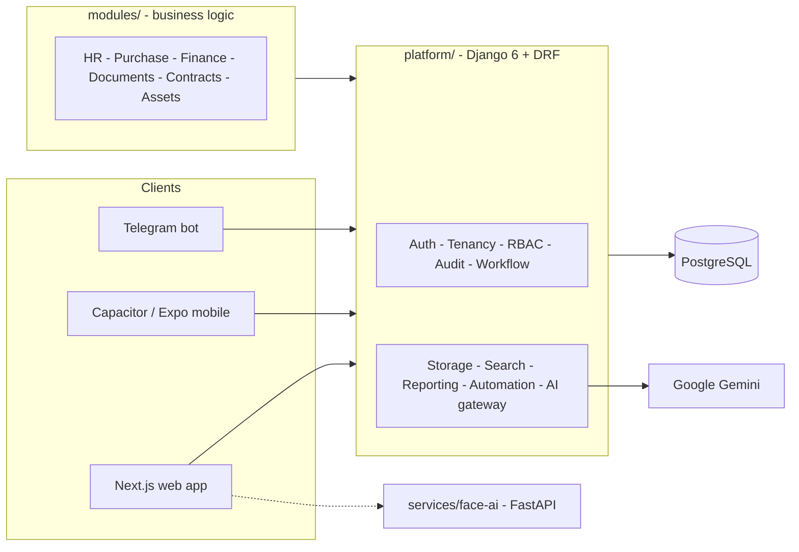

<div align="center">

# WWE OS

**One operating system for a whole company: HR, purchasing, invoicing, documents, contracts and delivery challans on a shared multi-tenant kernel, with an AI co-pilot and face-recognition attendance.**

[](https://github.com/rithvin-us/wwe-OS/actions/workflows/ci.yml)
[](https://github.com/rithvin-us/wwe-OS/actions/workflows/codeql.yml)


[Overview](#overview) · [Features](#features) · [Architecture](#architecture) · [Quickstart](#quickstart) · [Quality gates](#quality-gates) · [Docs](#documentation)

</div>

---

## Overview

WWE OS (Water Works Engineering OS) replaces the usual pile of spreadsheets, paper challans and single-purpose tools with one platform. A small Django **kernel** provides the shared capabilities (auth, tenancy, workflow, audit, storage, search, AI gateway). Business **modules** plug into it and add the domain logic.

It is built for a company run by one person who is HR, IT and accounts at once:

- **Task cockpit, not silos.** The dashboard answers "what needs my attention today?" across every area.
- **Automation first.** Modules ship self-service and scheduled paths first. The operator handles exceptions.
- **Mobile-first.** Same API and design tokens for the web app, a Capacitor Android wrapper and an Expo app.
- **Ready to grow.** Multi-tenancy and RBAC are built in but dormant. Switch them on when a second person joins.

Two capabilities front the product:

| | |
| --- | --- |
| **Rithu AI** | Contextual business co-pilot. Ask questions about company data, use slash commands and `@`-mentions. Runs on Google Gemini through the platform AI gateway. |
| **Face-AI** | Face-recognition check-in for attendance. ArcFace and MTCNN with anti-spoofing and liveness checks, as a standalone FastAPI service. |

## Features

| Area | What it does |
| --- | --- |
| **HR** | Employees, attendance, payroll, statutory registers, leave, onboarding, expenses, face check-in. |
| **Purchases** | Bill ingestion over Telegram with OCR and AI extraction. |
| **Invoices / Finance** | Invoicing and financial summaries. |
| **Delivery Challans** | Challans from Word templates to PDF, with a SHA-256 verification hash. |
| **Documents** | Document vault with storage abstraction and full-text search. |
| **Contracts** | Contract lifecycle tracking. |
| **Automation** | Scheduled collection of tagged records into packages, reports and auditor folders. |
| **Workspace** | Daily briefing, assistant, approvals and deadlines in one cockpit. |

Modules still in progress (inventory, maintenance, vendors, visitors, chatbot, reports) are listed in [`modules/`](modules/) and marked as such in the app.

## Architecture



Rules that keep it maintainable:

1. Business logic lives only in `modules/`. The kernel provides capabilities, never business models.
2. Modules never import each other. They talk through platform contracts and domain events.
3. No module calls an AI provider. Everything goes through the `platform/ai` gateway.
4. Tenant-owned data is tenant-scoped from day one.
5. `services/` are deployment-isolated and integrate over API or queue only.

### Repository layout

```
apps/        web (Next.js) - mobile (Expo) - admin - employee
platform/    Django kernel: auth, tenancy, permissions, audit, workflow, ai, storage, search ...
modules/     hr - purchase - finance - documents - contracts - assets - ...
services/    face-ai - telegram-bot - ocr - email-service - scheduler - worker - webhook-engine - ai-engine
packages/    design-system - ui - icons - charts - theme - sdk - shared-types - utils
database/  infrastructure/  scripts/  docs/
```

### Stack

| Layer | Technology |
| --- | --- |
| Frontend | Next.js 16, React 19, TypeScript, Tailwind v4, shadcn-based `@bop/ui`, TanStack Query, React Hook Form, Zod |
| Mobile | Capacitor (Android), Expo / React Native |
| Backend | Python, Django 6, Django REST Framework, JWT |
| Face-AI | FastAPI, ArcFace, MTCNN, OpenCV |
| AI | Google Gemini via the platform gateway |
| Data | PostgreSQL, Redis |
| Tooling | pnpm workspaces, Biome, Ruff, Vitest, Pytest, pre-commit, Gitleaks |
| Deploy | Vercel (frontend), Render (backend and services), Cloudflare Tunnel (Face-AI) |

## Quickstart

**Needs:** Node.js 20+, pnpm, Python 3.12, Docker.

```bash
git clone https://github.com/rithvin-us/wwe-OS.git
cd wwe-OS
cp .env.example .env            # set DJANGO_SECRET_KEY, GEMINI_API_KEY, ...

docker compose up -d            # Postgres, Redis, Mailpit

pnpm install
pip install -r platform/requirements.txt -r platform/requirements-dev.txt

cd platform && python manage.py migrate && cd ..

pnpm dev                        # web + Django + Face-AI
```

| Service | URL |
| --- | --- |
| Web app | http://localhost:3000 |
| API | http://localhost:8000/api/v1/ |
| Face-AI | http://localhost:9000 |
| Mailpit | http://localhost:8025 |

Face-AI needs its ML dependencies from `services/face-ai/requirements-ml.txt`.

## Quality gates

These are what CI runs. Run them before opening a PR.

```bash
# Frontend
pnpm exec biome ci .
pnpm --filter web lint
pnpm exec tsc --noEmit -p apps/web/tsconfig.json
pnpm --filter web test
pnpm --filter web build

# Backend
python -m ruff check . && python -m ruff format --check .
cd platform && python manage.py check && pytest
```

Pre-commit runs Ruff, Biome, Gitleaks and hygiene hooks: `python -m pre_commit run --all-files`.

## Documentation

- [Architecture overview](docs/architecture/01-project-overview.md)
- [Platform kernel](docs/architecture/platform-kernel.md)
- [Design Bible](docs/design/design-bible.md) - the UI rules
- [Module blueprints](docs/modules/) and [engineering specs](docs/specs/)
- [HR migration](docs/specs/hr-migration.md)
- [Roadmap](docs/roadmap/development-roadmap.md)
- [Security policy](SECURITY.md)

## Contributing

Use Conventional Commits (`feat(hr): ...`, `fix(platform/auth): ...`). Record architectural decisions as an ADR in [`docs/adr/`](docs/adr/).

## License

Proprietary. All rights reserved. Copyright 2026 Water Works Engineering.
