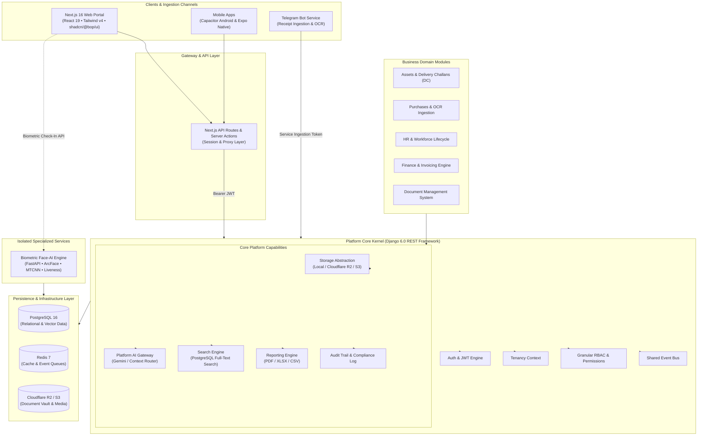

<div align="center">

# 🌊 Water Works Engineering OS (WWE OS)

### Enterprise Business Operations & AI Intelligence Platform

[](.github/workflows/ci.yml)
[](https://nextjs.org/)
[](https://www.djangoproject.com/)
[](https://fastapi.tiangolo.com/)
[](https://www.python.org/)
[](https://www.typescriptlang.org/)
[](https://tailwindcss.com/)
[](https://biomejs.dev/)
[](SECURITY.md)

<p align="center">
  <strong>Unifying industrial operations with real-time business intelligence, touchless biometric AI security, autonomous procurement ingestion, and automated workflow orchestration.</strong>
</p>

[System Architecture](#-system-architecture) •
[Core Modules](#-platform-capabilities--modules) •
[Business ROI](#-commercial-value--roi) •
[Monorepo Layout](#-monorepo-structure) •
[Quickstart](#-quickstart--local-development) •
[Testing & Quality](#-testing--code-quality) •
[Security](#-enterprise-security--governance)

---

</div>

## 📌 Executive Summary

**Water Works Engineering OS (WWE OS)** is a unified, enterprise-grade Business Operations Platform purpose-built for engineering, manufacturing, and industrial service enterprises. 

In traditional field and manufacturing operations, mission-critical workflows are siloed across disconnected spreadsheets, paper delivery challans, legacy accounting tools, and disjointed HR apps. **WWE OS** eliminates this operational fragmentation by integrating **Workforce & Biometric Security, Financial Intelligence, Logistics & Delivery Challans, Autonomous Purchase Ingestion, and AI-Powered Document Management** into a single, cohesive command center.

Designed around a high-efficiency **Single-Operator Cockpit** backed by an enterprise multi-tenant kernel, WWE OS brings together two flagship AI engines:
1. **Rithu AI** — A contextual enterprise operations co-pilot powered by Google Gemini, capable of multimodal RAG queries, instant metric extraction, and workflow assistance.
2. **Face-AI** — A sub-second edge biometric microservice built on ArcFace and MTCNN deep neural networks with active liveness verification for fraud-proof attendance.

---

## 🏗️ System Architecture

WWE OS is structured as a scalable, high-performance monorepo adhering to clean architectural boundaries. Modules communicate with the platform kernel via domain events and standardized service contracts—never through direct cross-module coupling.



---

## 🚀 Platform Capabilities & Modules

### 1. 🤖 Rithu AI — Enterprise Operations Co-Pilot
* **Context-Aware Business Intelligence**: Natural language queries across operational data—ask about revenue trends, unpaid vendor invoices, stock status, or shift rosters.
* **Multimodal Document RAG**: Drag-and-drop contracts, engineering blueprints, invoices, or receipts for instant extraction, analysis, and executive summaries.
* **Slash Commands & Mentions**: Rapid query shortcuts (`/stats`, `/summarize`, `/email`, `@invoice`, `@employee`) for keyboard-first operational velocity.
* **Automated Vendor Outreach**: Instant context-aware generation of quote requests, invoice reminders, and official correspondence.

### 2. 🛡️ Biometric Face-AI & Workforce Management
* **Sub-Second Biometric Check-In**: Powered by MTCNN face detection and ArcFace deep neural feature extraction running on PyTorch and OpenCV.
* **Anti-Spoofing & Liveness Detection**: Enterprise-grade liveness validation preventing photo, video, and screen replay attacks.
* **End-to-End HR Lifecycle**: Integrated employee directory, automated shift scheduling, statutory compliance registers, leave tracking, and payroll readiness.

### 3. 🚚 Delivery Challans (DC) & Asset Logistics
* **Dynamic Document Generation**: Automated rendering of official Delivery Challans using Word (`.docx`) template pipelines and high-fidelity PDF output.
* **SHA-256 Tamper-Proof Verification**: Every generated challan carries an immutable cryptographic verification hash to ensure chain of custody.
* **Flexible Field Operations**: Free-text delivery items, customizable units of measure (Kg, Litre, Nos, Mtr, Lot, Set), site-specific consignee details, and audit history.

### 4. 🧾 Autonomous Purchase Ingestion & Accounts Payable
* **Telegram Bot Bill Ingestion**: Snap photos of bills on-site via Telegram; receipts are securely transferred and stored automatically.
* **Multimodal OCR & Data Extraction**: Intelligent extraction of vendor names, invoice numbers, tax breakdowns, line items, and payment dates via the Platform AI Gateway.
* **3-Way Matching & Bill Auditing**: Automatic cross-referencing between purchase orders, challans, and vendor invoices to prevent double-billing.

### 5. 📁 Intelligent Document Vault (DMS)
* **Centralized Engineering Repository**: High-durability storage for engineering drawings, compliance certificates, warranty records, and service agreements.
* **High-Durability Cloud Storage**: Abstracted storage adapter supporting Cloudflare R2, AWS S3, or local encrypted storage.
* **Automated Categorization & Full-Text Search**: AI indexing enabling deep semantic search inside PDF, DOCX, and scanned document archives.

### 6. 💼 Financial Cockpit & Cash Flow Analytics
* **Real-Time Financial Health**: Instant visibility into Revenue, Operational Costs, EBITDA, Net Margin, and accounts receivable.
* **Vendor Aging & Payment Alerts**: Automated tracking of payment cycles, preventing vendor friction and penalty fees.

### 7. 📊 Executive Command Center
* **Single-Operator Task Cockpit**: Unified "Needs Your Attention" cross-cutting surface consolidating pending approvals, operational deadlines, and anomaly alerts.
* **Daily Morning Executive Briefing**: Automated AI digest summarizing upcoming deadlines, personnel shifts, and daily critical tasks.

---

## 💡 Commercial Value & ROI

| Traditional Industrial Operations | WWE OS Platform Solution | Measurable Business ROI |
| :--- | :--- | :--- |
| **Fragmented Software Subscriptions**<br/>(Multiple disconnected point solutions) | **Unified Monorepo Architecture**<br/>Single system managing HR, Assets, Logistics, and Finance | **40%+ Reduction** in software licensing and integration overhead |
| **Attendance Fraud & Buddy Punching**<br/>Manual sign-in sheets or swipe cards | **ArcFace Biometric Liveness AI**<br/>Edge facial verification with active anti-spoofing | **Zero Time Theft** & 100% auditable biometric payroll integrity |
| **Slow Manual Procurement & Filing**<br/>Lost paper receipts and manual data entry | **Telegram Bot + AI OCR Ingestion**<br/>Instant bill capture, auto-extraction, and 3-way matching | **85% Faster** invoice processing and accounts payable turnaround |
| **Logistics Disputes & Tampering**<br/>Unverified paper delivery challans | **Cryptographically Signed DCs**<br/>SHA-256 verified PDF challans with immutable audit trails | **100% Chain-of-Custody** verification for on-site equipment movement |
| **Scattered Operational Knowledge**<br/>Slow cross-department communications | **Rithu AI Operations Co-Pilot**<br/>Instant natural-language queries across operational data | **90% Faster** decision-making and operational metric discovery |

---

## 📂 Monorepo Structure

```
wwe-os/
├── apps/
│   ├── web/                    # Next.js 16 executive portal & operator dashboard
│   ├── mobile/                 # Expo & React Native mobile client
│   ├── admin/                  # Enterprise administration application
│   └── employee/               # Employee self-service interface
├── platform/                   # Core Django 6.0 REST platform kernel
│   ├── auth/                   # Stateless JWT authentication & identity
│   ├── tenancy/                # Multi-tenant isolation & actor context
│   ├── permissions/            # Granular capability & RBAC permission registry
│   ├── ai/                     # Unified Platform AI Gateway (Gemini/OpenAI)
│   ├── storage/                # Storage provider abstraction (S3 / R2 / Local)
│   ├── audit/                  # Tamper-resistant enterprise audit logging
│   ├── workflow/               # Cross-cutting approval & state engine
│   └── shared/                 # Shared domain event bus & common utilities
├── modules/                    # Isolated business domain modules
│   ├── assets/                 # Equipment tracking & Delivery Challan (DC) engine
│   ├── hr/                     # Workforce management, shifts, and payroll
│   ├── purchase/               # Purchase bills, Telegram bot ingestion & OCR
│   ├── finance/                # Invoicing, cash flow, and cost tracking
│   ├── dms/                    # Document Vault & AI semantic search
│   └── contracts/              # Vendor & client legal contract lifecycle
├── services/                   # Deployment-isolated microservices
│   ├── face-ai/                # Biometric ArcFace/MTCNN facial recognition (FastAPI)
│   ├── telegram-bot/           # Ingestion bot for on-the-go bill receipts
│   ├── email-service/          # Transactional notification dispatcher
│   ├── ocr/                    # Optical Character Recognition worker
│   └── scheduler/              # Automated cron routines & backup orchestrator
├── packages/                   # Reusable TypeScript packages
│   ├── design-system/          # Core CSS variables, tokens, and theme rules
│   ├── ui/                     # Shared accessible UI component library (@bop/ui)
│   ├── icons/                  # Unified icon catalog (@bop/icons)
│   ├── charts/                 # Analytics & dashboard charting components
│   └── sdk/                    # Type-safe API client & shared utilities
├── database/                   # Migrations, seeding fixtures, and schemas
├── infrastructure/             # Docker Compose, Render configurations, and tunnels
├── scripts/                    # Automation utilities and unified dev runners
└── docs/                       # Architecture diagrams, design bible, and specs
```

---

## 🛠️ Technology Stack

| Layer | Technologies |
| :--- | :--- |
| **Frontend Portal** | Next.js 16 (App Router), React 19, TypeScript 5.7, Tailwind CSS v4, `@bop/ui` (shadcn-based), TanStack Query, React Hook Form, Zod |
| **Mobile Clients** | Capacitor Android Native Wrapper, Expo (React Native) |
| **Backend Kernel** | Python 3.12, Django 6.0, Django REST Framework, SimpleJWT, Dj-Database-URL, Gunicorn |
| **Biometric & AI Services** | FastAPI, PyTorch, MTCNN, InsightFace / ArcFace, ONNX Runtime, OpenCV, Google Gemini (`gemini-flash-latest`) |
| **Databases & Cache** | PostgreSQL 16 (with Full-Text Search), Redis 7 (caching and event pub/sub) |
| **Ingestion & Messaging** | Python-Telegram-Bot, HTTPX, Event Bus |
| **Storage & Document Processing** | Cloudflare R2 / AWS S3, python-docx, ReportLab, PyPDF |
| **Tooling & Quality** | Biome (JS/TS formatting & linting), Ruff (Python linting & formatting), Pytest, Vitest, Gitleaks, Pre-commit |

---

## ⚡ Quickstart & Local Development

### Prerequisites

Ensure the following runtimes and tools are installed on your workstation:
- **Node.js**: `v20.x` or `v22.x` (LTS recommended)
- **pnpm**: `v9.x` (`corepack enable && corepack prepare pnpm@latest --activate`)
- **Python**: `v3.12`
- **Docker & Docker Compose**: For local PostgreSQL, Redis, and Mailpit services

---

### Step 1: Clone Repository & Configure Environment

```bash
git clone https://github.com/your-org/wwe-os.git
cd wwe-os
cp .env.example .env
```

> Edit `.env` to configure your local keys (e.g., `DJANGO_SECRET_KEY`, `GEMINI_API_KEY`, `TELEGRAM_BOT_TOKEN`).

---

### Step 2: Launch Local Infrastructure

Start PostgreSQL, Redis, and Mailpit via Docker Compose:

```bash
docker compose up -d postgres redis mailpit
```

---

### Step 3: Install Dependencies

#### JavaScript / Monorepo Packages
```bash
pnpm install
```

#### Python Dependencies (Platform Backend & AI Services)
Create and activate a virtual environment, then install dependencies:
```bash
# Optional: create a virtualenv
python3 -m venv .venv
source .venv/bin/activate  # On Windows: .venv\Scripts\activate

# Install master platform requirements
pip install -r requirements.txt
```

---

### Step 4: Database Migrations & Initial Setup

Run Django migrations to provision database schemas and seed default roles and permissions:

```bash
cd platform
python manage.py migrate
cd ..
```

---

### Step 5: Start All Services (Single Command)

Launch the Next.js frontend, Django kernel, and Face-AI microservice concurrently:

```bash
pnpm dev
```

#### Service Port Mapping:

| Service | Protocol / Port | Local Endpoint | Notes |
| :--- | :--- | :--- | :--- |
| **Executive Web Portal** | HTTP `:3000` | `http://localhost:3000` | Main operator dashboard & UI |
| **Platform REST Kernel** | HTTP `:8000` | `http://localhost:8000/api/v1/health/` | Core API, Auth, & Business Modules |
| **Face-AI Microservice** | HTTP `:9000` | `http://localhost:9000/health` | ArcFace / MTCNN Biometric Service |
| **Mailpit Web UI** | HTTP `:8025` | `http://localhost:8025` | Local SMTP capture & testing interface |
| **PostgreSQL Database** | TCP `:5432` | `localhost:5432` | Relational persistence |
| **Redis Cache & Broker** | TCP `:6379` | `localhost:6379` | Key-value cache and event messaging |

---

## 🧪 Testing & Code Quality

The repository enforces strict continuous integration (CI) quality gates across frontend and backend codebases.

### Frontend Quality Suite
```bash
# Lint and format checking with Biome
pnpm lint
pnpm format:check

# Next.js specific linting rules
pnpm lint:next

# TypeScript typechecking
pnpm exec tsc --noEmit -p apps/web/tsconfig.json

# Frontend unit & component tests (Vitest)
pnpm --filter web test

# Production build verification
pnpm --filter web build
```

### Backend Quality Suite
```bash
# Python linting and code formatting with Ruff
python -m ruff check .
python -m ruff format --check .

# Django system checks
cd platform
python manage.py check

# Backend automated test suite (Pytest)
pytest
```

### Pre-Commit & Security Auditing
```bash
# Run all pre-commit hooks (Biome, Ruff, Gitleaks, Hygiene)
python -m pre_commit run --all-files

# Scan working tree for secrets with Gitleaks
docker run --rm -v "$PWD:/repo" zricethezav/gitleaks:v8.24.3 dir /repo --no-banner -v --config /repo/.gitleaks.toml
```

---

## 🔒 Enterprise Security & Governance

- **Zero-Trust Token Authentication**: All platform requests require cryptographically signed, stateless Bearer JWTs; service-to-service communications are authenticated via isolated ingestion tokens.
- **Dormant Enterprise RBAC**: Multi-tenant database schemas and granular permission trees are architected directly into the kernel, ready to activate as operational teams expand.
- **Audit Trails**: Critical operations (document deletions, challan generations, shift sign-offs) write immutable log entries.
- **Secrets Hygiene**: Verified zero-secret commitment through mandatory multi-pass Gitleaks scanning in CI and pre-commit hooks.
- **Data Protection**: TLS 1.3 enforced for data in transit; AES-256 encryption supported for cold document vault storage.

---

## 📖 Key Documentation

For deep technical dives, refer to our comprehensive documentation library:

- **[System Architecture Guide](docs/architecture/01-project-overview.md)** — Architectural boundaries, design principles, and service maps.
- **[Platform Kernel Specification](docs/architecture/platform-kernel.md)** — Django core structure, capability apps, and event bus.
- **[Design Bible](docs/design/design-bible.md)** — Design tokens, component rules, color palettes, and UX guidelines.
- **[Delivery Challans Specification](docs/specs/assets-spec.md)** — Cryptographic hashing, document rendering, and logistics flow.
- **[HR & Biometric Migration](docs/specs/hr-migration.md)** — Shift engines, payroll algorithms, and Face-AI verification pipeline.
- **[Security Policy](SECURITY.md)** — Vulnerability reporting and compliance protocols.

---

## 📄 License & Intellectual Property

Proprietary commercial software. All rights reserved.  
Copyright © 2026 **Water Works Engineering (WWE OS)**.  
Unauthorized copying, reverse engineering, or distribution of this software is strictly prohibited.
